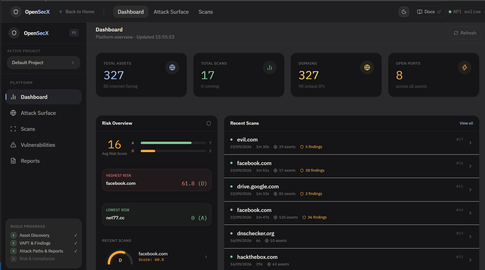

<h1 align="center">
  
  <br/>
  OpenSecX
</h1>

<p align="center">
  <strong>Open-source attack surface management & vulnerability intelligence platform</strong><br/>
  Asset discovery · VAPT scanning · Risk scoring · OWASP/CIS/NIST compliance · Attack path correlation
</p>

<p align="center">
  
  
  
  
  
</p>

---

## What is OpenSecX?

OpenSecX is a **self-hosted, pure-Python** security reconnaissance and vulnerability assessment platform. It unifies asset discovery, VAPT scanning, risk intelligence, and compliance mapping into a single open-source tool — built for security teams that demand clarity over complexity.

No proprietary binary dependencies. No cloud lock-in. Runs entirely on Windows, macOS, and Linux.

---

## Screenshots

<table>
  <tr>
    <td><strong>Dashboard — Live Risk Overview</strong></td>
    <td><strong>Scan Report — Attack Paths</strong></td>
  </tr>
  <tr>
    <td></td>
    <td></td>
  </tr>
  <tr>
    <td><strong>Risk & Compliance — Score Gauge</strong></td>
    <td><strong>Reports — All Scans</strong></td>
  </tr>
  <tr>
    <td></td>
    <td></td>
  </tr>
</table>

---

## Features

### Phase 1 — Asset Discovery & OSINT
- **Subdomain enumeration** via crt.sh certificate transparency logs
- **DNS resolution** — A, AAAA, MX, NS, TXT, CNAME, CAA records
- **WHOIS** metadata — registrar, creation date, expiry, nameservers
- **IP enrichment** — ASN, organization, country via IPInfo API
- **TLS certificate** analysis — subject, issuer, expiry, SAN, cipher, TLS version
- **HTTP probing** — live service detection, redirect following, response headers
- **Port scanning** — pure Python async TCP scan of top common ports
- **Wayback Machine** — historical CDX API for exposed URL discovery

### Phase 2 — Vulnerability Assessment
- **Security headers** — HSTS, CSP, X-Frame-Options, Referrer-Policy, Permissions-Policy
- **CORS misconfiguration** — permissive origins, credentials exposure
- **Cookie security** — Secure, HttpOnly, SameSite, SameSite=None without Secure
- **CVE intelligence** — cve.circl.lu lookups matched to detected technologies
- **EPSS scoring** — FIRST.org exploit prediction per CVE
- **CISA KEV** — checks every CVE against the Known Exploited Vulnerabilities catalog
- **Finding triage** — confirm, false positive, accept risk per finding

### Phase 3 — Attack Paths & Reports
- **Attack path correlation** — chains assets → services → technologies → CVEs → OWASP techniques → business impact
- **Evidence grading** — `confirmed` / `supported` / `possible` per chain step
- **JSON report** — full structured export via API
- **HTML report** — self-contained, zero-dependency HTML download
- **Priority sorting** — KEV findings surface first

### Phase 4 — Risk Scoring & Compliance
- **Composite risk score** (0–100) with letter grade A–F
  - Vulnerability severity score (0–50, weighted + EPSS boost)
  - CISA KEV penalty (0–20, +7 per KEV finding)
  - Exposure score (0–15, high-risk ports: Redis, MongoDB, RDP, etc.)
  - Hygiene score (0–15, TLS/header/cookie misconfigs)
- **OWASP Top 10 2021** — full coverage matrix, per-category finding counts
- **CIS Controls** — gap identification mapped from OWASP categories
- **NIST CSF** — function-level mapping (PR.AC, PR.DS, DE.CM, etc.)
- **Port exposure analysis** — high-risk service detection with remediation guidance
- **Historical backfill** — scores all past scans automatically

---

## Architecture

```
OpenSecX/
├── backend/                  # FastAPI + SQLAlchemy + SQLite
│   └── app/
│       ├── api/endpoints/    # scans · assets · findings · risk · stats
│       ├── models/           # Asset · ScanJob · Finding · RiskScore
│       ├── scanners/         # 12 pure-Python adapters (no binaries)
│       └── services/         # discovery · vuln_orchestrator · attack_path
│                               risk_scorer · report_export
└── frontend/                 # React 18 + TypeScript + Vite
    └── src/
        ├── api/client.ts     # Typed API client (axios)
        ├── pages/            # Dashboard · AttackSurface · Scans
        │                       ScanReport · Vulnerabilities · Reports · RiskPage
        └── components/       # AppLayout · Sidebar · AssetGraph · HeroCanvas
```

**Scan pipeline** (sequential, fail-soft — missing tools = `unavailable`, not crash):

```
crt.sh → DNS → IPInfo → TLS → HTTP Probe → Port Scan → WHOIS → Wayback
          ↓ (full profile)
Security Headers → CORS → Cookie → CVE/EPSS/KEV
          ↓
Attack Path Correlation → Risk Score → Report Export
```

---

## Quick Start

### Prerequisites
- Python 3.11+
- Node.js 18+

### Backend
```bash
cd backend
python -m venv venv

# Windows
.\venv\Scripts\activate

# macOS / Linux
source venv/bin/activate

pip install -r requirements.txt
uvicorn app.main:app --reload --host 0.0.0.0 --port 8000
```

### Frontend
```bash
cd frontend
npm install
npm run dev
```

Open **http://localhost:5173** — the API must be running on port 8000.

### Backfill risk scores for existing scans
```bash
curl -X POST http://localhost:8000/api/v1/risk/backfill
```

---

## API Reference

| Method | Endpoint | Description |
|--------|----------|-------------|
| `POST` | `/api/v1/scans/start` | Start a new scan |
| `GET`  | `/api/v1/scans/` | List all scans |
| `GET`  | `/api/v1/scans/{id}` | Scan status |
| `GET`  | `/api/v1/scans/{id}/report` | Full JSON report |
| `GET`  | `/api/v1/scans/{id}/report.html` | Download HTML report |
| `GET`  | `/api/v1/scans/{id}/attack-paths` | Attack chains |
| `GET`  | `/api/v1/assets/` | List discovered assets |
| `GET`  | `/api/v1/findings/` | List findings (filter by scan, severity, KEV) |
| `PATCH`| `/api/v1/findings/{id}/triage` | Triage a finding |
| `GET`  | `/api/v1/risk/{scan_id}` | Risk score + compliance |
| `GET`  | `/api/v1/risk/summary` | Aggregate risk across all scans |
| `POST` | `/api/v1/risk/{id}/recalculate` | Force risk recalculation |
| `POST` | `/api/v1/risk/backfill` | Score all unscored completed scans |
| `GET`  | `/api/v1/stats/` | Platform statistics |

Full interactive docs: **http://localhost:8000/docs**

---

## Tech Stack

| Layer | Technology |
|-------|-----------|
| Backend framework | FastAPI 0.115 |
| ORM | SQLAlchemy 2.0 (async) |
| Database | SQLite (via aiosqlite) |
| HTTP client | httpx (async) |
| Frontend framework | React 18 + Vite 8 |
| Language | TypeScript 5 |
| Styling | Vanilla CSS (design system tokens) |
| API client | Axios |

---

## Scanners (all pure Python, no binaries)

| Scanner | Data Source | What it provides |
|---------|------------|-----------------|
| `crtsh.py` | crt.sh API | Subdomain enumeration via CT logs |
| `dns_scanner.py` | Python `dnspython` | Full DNS record resolution |
| `tls_scanner.py` | Python `ssl` stdlib | Certificate chain, cipher, TLS version |
| `http_prober.py` | `httpx` async | Live service detection, tech fingerprinting |
| `port_scanner.py` | Python `asyncio` | TCP connect scan of top 50+ ports |
| `whois_scanner.py` | `python-whois` | Registrar, dates, nameservers |
| `ipinfo_scanner.py` | ipinfo.io API | ASN, org, country, city |
| `wayback_scanner.py` | Wayback CDX API | Historical URL exposure |
| `security_headers_scanner.py` | HTTP response | HSTS, CSP, X-Frame, etc. |
| `cors_scanner.py` | HTTP probe | Origin reflection, credentials |
| `cookie_scanner.py` | HTTP response | Secure, HttpOnly, SameSite flags |
| `cve_scanner.py` | cve.circl.lu + FIRST.org | CVE, CVSS, EPSS, KEV lookup |

---

## Risk Scoring Formula

```
Score (0–100) = Vuln Score (0–50) + KEV Penalty (0–20) + Exposure (0–15) + Hygiene (0–15)

Grade:  A = 0–19  |  B = 20–39  |  C = 40–59  |  D = 60–74  |  F = 75+
```

- **Vulnerability**: `Σ (severity_weight × finding) + EPSS × 5`
  - Critical=25 · High=10 · Medium=4 · Low=1
- **KEV Penalty**: `min(20, kev_count × 7)`
- **Exposure**: `+4 per high-risk port` (Redis/MongoDB/RDP/etc.) `+0.5 per non-standard port`
- **Hygiene**: `min(15, hygiene_finding_count × 2)`

---

## License

MIT — see [LICENSE](LICENSE)
